<picture>
  <source media="(prefers-color-scheme: dark)" srcset="assets/header-dark.svg">
  
</picture>

Fullstack product engineer with 8+ years of experience in health and fintech, from backend services to pixels. Currently building patient and clinic apps at [avi](https://avimedical.com).

#### currently shipping with
- **frontend:** react · react native · electron · next.js
- **backend:** java / quarkus · python / django · node.js · postgres · mysql
- **infra:** gitops · kubernetes · gcp
- **ai:** agents · skills · mcp tooling

#### been there, shipped that
angular · ruby on rails · wordpress / php · aws · azure

#### side
- [nizza-markenklasse.de](https://nizza-markenklasse.de): trademark class search
- [zahlt-die-bu.de](https://zahlt-die-bu.de): disability insurers ranked by bafin complaint stats

 

<a href="https://www.linkedin.com/in/johannes-hinterstoesser/"><picture><source media="(prefers-color-scheme: dark)" srcset="assets/linkedin-dark.svg"></picture></a>&nbsp;<a href="https://medium.com/@jhinter"><picture><source media="(prefers-color-scheme: dark)" srcset="assets/medium-dark.svg"></picture></a>

